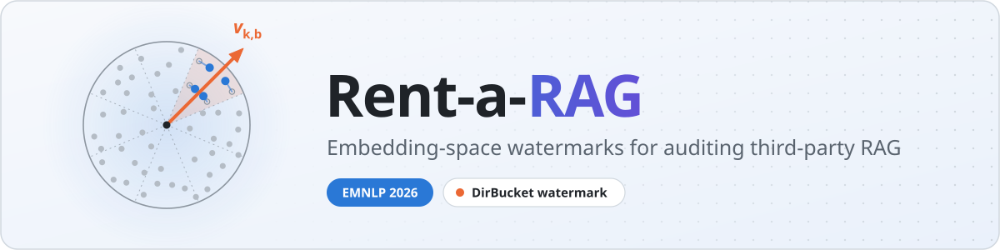
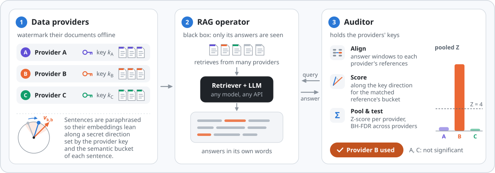
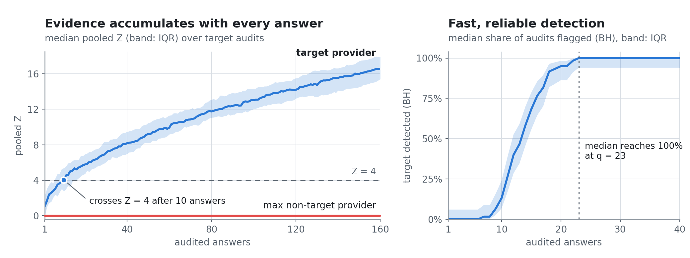
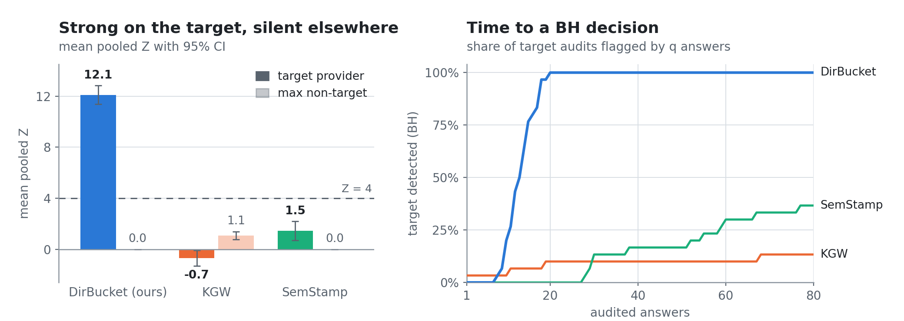

<p align="center">
  <picture>
    <source media="(prefers-color-scheme: dark)" srcset="docs/assets/banner-dark.svg">
    
  </picture>
</p>

<p align="center">
  <a href="#citation"></a>
  <a href="pyproject.toml"></a>
  <a href="LICENSE"></a>
  <a href="tests"></a>
  <a href="#bring-your-own"></a>
</p>

<p align="center">
  <b>Watermark the documents you license to a RAG service, then detect from its answers alone whether it still uses them.</b>
</p>

<p align="center">
  <a href="#quick-start">Quick start</a> ·
  <a href="#bring-your-own">Bring your own LLM</a> ·
  <a href="docs/library.md">Docs</a> ·
  <a href="#reproduce-the-paper">Reproduce the paper</a> ·
  <a href="#citation">Citation</a>
</p>

---

This is the official code for **Rent-a-RAG: Embedding-Space Watermarks for Auditing Third-Party RAG**
(EMNLP 2026) by Alexandr Goultiaev Tolstokorov, Kyriakos Mouratidis, Javad Dogani and Nikolaos Laoutaris
(IMDEA Networks Institute, Universidad Carlos III de Madrid, Singapore Management University).
It ships the paper's method, **DirBucket**, as `rentarag`, a pip-installable library and CLI. You can
use it with any LLM or API, any sentence encoder, any corpus format and any number of providers.

## Why

In a RAG data marketplace, providers license their corpora to an operator who runs retrieval and
generation. Once the documents are handed over, the provider cannot see whether the operator keeps
using them. The operator does not cooperate, the generator paraphrases everything, and one answer can
mix content from many providers. DirBucket hides a key-dependent signal in the *meaning* of each
document, so the signal survives paraphrasing. An auditor can then test every provider from black-box
answers, with false-discovery-rate control.

<picture>
  <source media="(prefers-color-scheme: dark)" srcset="docs/assets/overview-dark.svg">
  
</picture>

<sub>Each provider paraphrases its documents so that sentence embeddings lean along a direction set by its
secret key and each sentence's semantic bucket. The auditor sees only the RAG's answers. It aligns each
answer window to the published documents, scores it along the provider's key direction for the matched
reference's bucket, pools the evidence into one Z-score per provider, and flags providers that pass
BH-FDR.</sub>

## Highlights

- **Fast, reliable detection.** On the primary benchmark (six providers, mixed-provider retrieval,
  paraphrasing generator), DirBucket flags non-compliance in **every audit within 23 audited answers**.
- **Only the right provider lights up.** The paper compares DirBucket with KGW-adapted and
  SemStamp-adapted watermarks and with non-watermark attribution heuristics. DirBucket is the only one
  that consistently gives strong target detection with **no non-target activation**.
- **Survives post-answer laundering.** Every target audit is still detected (**30/30**, zero false
  positives) after neutral, repeated or aggressive paraphrasing, and after compressing answers to 50%.
  At 25% compression, 24/30 are detected, and 71% of judgments prefer the original answer.
- **Transfers to real data.** Clinical, cyber-threat-intelligence and legal corpora, two providers per
  domain, with an unchanged configuration: every target is detected (30/30), and no non-target provider
  accumulates decision-eligible evidence.

<picture>
  <source media="(prefers-color-scheme: dark)" srcset="docs/assets/results-dark.png">
  
</picture>

<sub>Evidence builds up with every audited answer. The target provider's median pooled Z crosses 4 after
10 answers, the strongest non-target provider stays at 0, and every target audit is flagged within 23
answers (paper, Fig. 4).</sub>

<details>
<summary><b>Comparison with adapted watermark baselines</b></summary>
<br>
<picture>
  <source media="(prefers-color-scheme: dark)" srcset="docs/assets/comparison-dark.png">
  
</picture>

<sub>Compared with the KGW-adapted and SemStamp-adapted baselines, only DirBucket gives strong evidence on
the target provider and none on the others, and it flags target audits fastest (paper, Fig. 2).</sub>
</details>

## Installation

```bash
git clone https://github.com/Sanya000/Rent-a-RAG.git && cd Rent-a-RAG
pip install -e ".[openai]"        # core library + OpenAI-compatible backends
```

| Extra | Adds |
|---|---|
| *(none)* | core: numpy, scipy, sentence-transformers, tqdm, pyyaml (local encoders, offline demos, CLI) |
| `[openai]` | OpenAI, Gemini, Ollama, vLLM and any OpenAI-compatible server |
| `[anthropic]` | Anthropic models |
| `[hf]` | local `transformers` chat models |
| `[litellm]` | every provider LiteLLM supports (Bedrock, Vertex, Azure, Mistral, ...) |
| `[all]` | all backends above |
| `[repro]` | plotting and model extras for the paper experiments in [`reproduce/`](reproduce) |
| `[dev]` | pytest, pyflakes |

Requires Python 3.10 or newer. [`requirements.txt`](requirements.txt) pins the exact paper environment.

## Quick start

**30 seconds, offline, no API key.** The bundled demo watermarks three providers, simulates a RAG
service that uses two of them, and audits it:

```bash
python examples/quickstart_offline.py
```

<details>
<summary>Output</summary>

```
[harbour-news] 4 docs, 100% of sentences rewritten, mean gain 0.172
[valley-health] 4 docs, 100% of sentences rewritten, mean gain 0.135
[city-culture] 4 docs, 100% of sentences rewritten, mean gain 0.157
  before: The harbour authority approved a new ferry terminal on Monday after a long public debate.
  after:  The harbour approved a new ferry terminal on Monday after a long public debate.

answers audited: 10
     provider      T        Z          p      q(BH)  eligible  DETECTED
 harbour-news     16     9.78   7.06e-23   1.06e-22      True       YES
valley-health      0     0.00   1.00e+00   1.00e+00     False         -
 city-culture     20     9.88   2.45e-23   7.34e-23      True       YES

detected providers: ['harbour-news', 'city-culture']
harbour-news Z with its key: 9.8; with 100 impostor keys: mean 0.13, sd 1.03
```

The demo uses a rule-based paraphraser and a toy encoder so it runs anywhere. Pass
`--llm openai/gpt-4o-mini --embedder sentence-transformers/all-mpnet-base-v2` for real components.
</details>

**On your own corpus and RAG system:**

```python
import rentarag

keys = rentarag.ProviderKeys.generate(["acme", "globex", "initech"])   # one secret key per provider
keys.save("provider_keys.json")

# Provider side: watermark the corpus with any LLM, then license the watermarked text
marked = rentarag.watermark_corpus("corpus.jsonl", keys, paraphraser="openai/gpt-4o-mini", max_workers=16)
marked.save("corpus_wm.jsonl")

# Auditor side: query the suspect RAG system as a black box
auditor = rentarag.Auditor.from_corpus(marked, keys)                   # paper detector settings
queries = rentarag.generate_audit_queries(marked, "openai/gpt-4o-mini", n=200)  # one question per sampled document
report = auditor.audit(rag_chain.invoke, queries)                      # any function: query -> answer
print(report)                                                          # T, Z, p, q(BH), DETECTED per provider
```

`generate_audit_queries` samples documents without replacement and reuses them only when `n` exceeds
the corpus size. `auditor.audit` keeps asking queries until a provider is detected. It accepts any callable, for example
`chain.invoke` (LangChain), `query_engine.query` (LlamaIndex) or a function that wraps an HTTP endpoint.
If you have already collected answers, pass them to `auditor.add_answers(answers)` and call
`auditor.report()`. See [`examples/audit_live_rag.py`](examples/audit_live_rag.py).

## Bring your own

Every component is chosen with a spec string or a plain Python function.

| Component | Options |
|---|---|
| **Paraphrase LLM** | `openai/gpt-4o-mini` · `anthropic/claude-haiku-5-5` · `gemini/gemini-2.5-flash` · `ollama/llama3.1` · `vllm/Qwen/Qwen2.5-7B-Instruct` · `hf/Qwen/Qwen2.5-1.5B-Instruct` · `litellm/<any model>` · any OpenAI-compatible server via `base_url=` · your own function `(sentence, n) -> list[str]` |
| **Encoder** | any sentence-transformers id (default `all-mpnet-base-v2`) · `openai/text-embedding-3-small` · `ollama/...` · `vllm/...` · `gemini/...` · your own function `texts -> array` |
| **Corpus** | `.jsonl[.gz]`, `.json`, `.csv`, `.tsv`, a directory of `.txt`/`.md` files (one sub-directory per provider), or Python dicts and tuples; field names are configurable |
| **Providers** | any number, named or numbered: `ProviderKeys.generate(50)` or `ProviderKeys.generate(["acme", "globex"])` |
| **Parameters** | watermark presets `paper` · `paper-corpus` · `fast` · `strong`; audit presets `paper` · `paper-query` · `small-corpus`; override any field |
| **Config file** | one YAML, TOML or JSON file for keys, LLM, encoder, watermark, audit and corpus fields (`rentarag init-config`) |

```python
paraphraser = rentarag.get_paraphraser("ollama/llama3.1")                                 # local model
paraphraser = rentarag.get_paraphraser(lambda sentence, n: my_llm.rewrite(sentence, n))   # your own code
config = rentarag.WatermarkConfig.preset("paper", rounds=4, n_candidates=16)              # cheaper watermark
audit = rentarag.AuditConfig.preset("paper", min_support=40, alpha=0.01)                  # stricter audit

marked = rentarag.watermark_corpus("corpus.csv", keys, paraphraser=paraphraser, config=config,
                                   embedder="BAAI/bge-small-en-v1.5", text_field="body")
auditor = rentarag.Auditor.from_corpus(marked, keys, audit, "BAAI/bge-small-en-v1.5")
```

The provider and the auditor use the same encoder. Watermarking is a one-time offline step. In the
paper it costs about 2.6 USD per 1000 sentences with `gpt-4o-mini`, and a local `Llama-3.1-8B-Instruct`
reaches 98% of that model's directional gain. Try every backend with
[`examples/any_llm.py`](examples/any_llm.py) (`--llm <spec>`). The [library guide](docs/library.md)
covers every option, and the [API reference](docs/api.md) lists every public name.

<details>
<summary><b>Paper operating point</b></summary>

| | Parameter | Value |
|---|---|---|
| Watermark | candidates per round K, rounds ρ, semantic floor τ_sem | 24, 6, 0.70 |
| Audit | window W / stride s, alignment τ_sim, margin τ_margin | 28 / 14 words, 0.82, 0.05 |
| Decision | support gate T_min, BH level α | 25, 0.05 |
| References | reference documents chosen per audit query | preset `paper-query` |
| Models | encoder, paraphraser | `all-mpnet-base-v2`, `gpt-4o-mini` |

These are the library defaults, except that the default auditor uses every published document as a
reference for every answer; `config="paper-query"` selects references per query as in the paper.
</details>

## Command line

```bash
rentarag init-config -o rentarag.yaml                     # commented config with the paper defaults
rentarag keygen --providers acme,globex,initech           # writes provider_keys.json
rentarag watermark --config rentarag.yaml -i corpus/ -o corpus_wm.jsonl --paraphraser ollama/llama3.1 --workers 8
rentarag queries --config rentarag.yaml --corpus corpus_wm.jsonl -n 200 -o queries.txt
rentarag audit --config rentarag.yaml --corpus corpus_wm.jsonl --queries queries.txt --rag-url http://localhost:8080/ask
```

`audit` also accepts `--rag-cmd "python my_rag.py"` (query on stdin, answer on stdout) or a file of
collected answers via `--answers answers.jsonl`. Command-line flags override the config file field by
field, and `--id-field` / `--provider-field` / `--text-field` set the corpus columns without one.

> [!IMPORTANT]
> **Keys are secrets.** Anyone holding a provider key can test for its watermark. Generate keys without
> `--seed` and store them like credentials. Seed 13 gives the public research keys used in the paper.

## Reproduce the paper

[`reproduce/`](reproduce) contains the paper's experiment code, one script per experiment, and the
result summaries behind every figure and table. The main figures regenerate from the shipped results in
minutes, without an API key:

```bash
cd reproduce && scripts/19_main_figures.sh
```

The [reproduction guide](reproduce/README.md) also covers re-running the main experiments on the
released corpora and rebuilding the benchmark from scratch. [`ARTIFACTS.md`](reproduce/ARTIFACTS.md)
lists the downloadable data. The library's test suite checks numerical equivalence with the paper
implementation (`pytest`; set `RUN_SLOW=1` to include the checks with real models).

## Repository layout

```
rentarag/      the library: keys, watermarker, auditor, statistics, LLM and encoder backends, CLI
examples/      runnable demos (offline quick start, any LLM, live RAG audit, example config)
docs/          library guide, API reference, figures
tests/         offline test suite, including equivalence tests against the paper code
reproduce/     paper experiments, scripts, configs and shipped results
```

## Citation

```bibtex
@inproceedings{goultiaev2026rentarag,
  title     = {Rent-a-{RAG}: Embedding-Space Watermarks for Auditing Third-Party {RAG}},
  author    = {Goultiaev Tolstokorov, Alexandr and Mouratidis, Kyriakos and Dogani, Javad and Laoutaris, Nikolaos},
  booktitle = {Proceedings of the 2026 Conference on Empirical Methods in Natural Language Processing (EMNLP)},
  year      = {2026}
}
```

## License

The code is released under the [MIT License](LICENSE). Files derived from FARAD (WARD) / RepLiQA keep
their original licences: `reproduce/results/llm_judge_*/`,
`reproduce/results/laundering_attack/utility_judge_results.json` and
`tests/fixtures/farad_dirbucket_naive_sample.jsonl` (see [`reproduce/ARTIFACTS.md`](reproduce/ARTIFACTS.md)).
